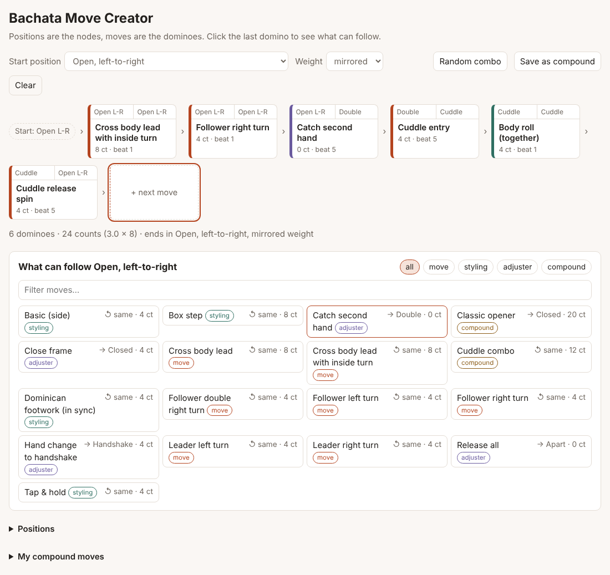
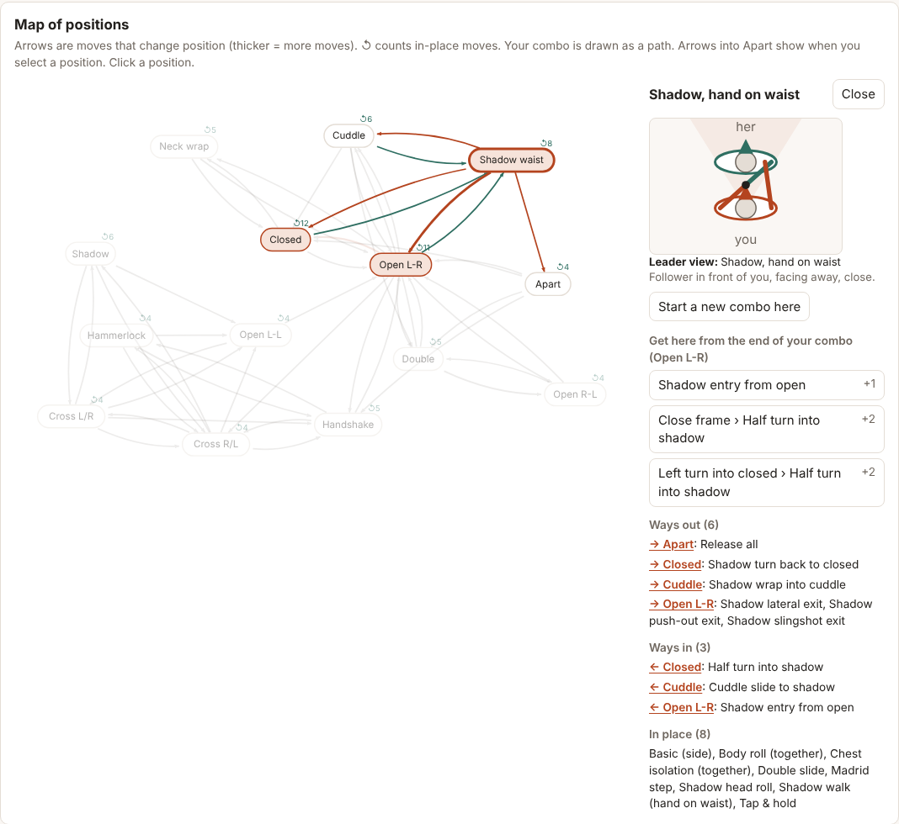

# Bachata Move Creator

Link social dance moves like dominoes and build new combinations.

**Live:** https://yahiaelsamman.github.io/bachata-move-creator/

- **Positions are the nodes.** A position is the state of the couple: orientation,
  frame, handhold, crossed hands and arm configuration.
- **Moves are the edges.** Every move starts in one position and ends in another, so
  two moves connect when the end of one matches the start of the next.
- **Combos are paths.** A move can be swapped for any other move with the same start
  and end, a combo can be cut at any position, and a group of moves can be saved as
  a single **compound move**.

It's a directed multigraph: several moves can connect the same two positions.



## Run it

No server needed. Open `index.html` (or `web/index.html`) in a browser.

After editing the data, rebuild and test:

```bash
npm install
npm run build   # validates data/*.yaml and writes web/data.js
npm test
```

## What you can do

The combo stays pinned at the top while you scroll. Below it are four tabs:
**Build** (what can follow, move details and the leader view), **Map**,
**Library** (all moves and positions) and **My moves**. Less-used actions (copy
as text, save as compound, clear, start weight) are in the **More** menu.

**Build combos**
- **+ next move** lists everything that can follow where you are (A–Z, filter by
  name or kind).
- **Random combo** builds 16, 32 or 48 counts in whole 8-counts (8-count moves start on 1) and comes back to the start position. It never drops both hands to reconnect, never undoes the move it just made, and uses each in-place move at most once. **Extend** keeps your combo and continues it.
- **Examples** load the compound moves from the data as a starting point.

**Edit combos**
- Click a domino to see details, or to:
  - replace it with a move that has the same start and end
  - insert a move after it (moves that keep the chain connected are listed first)
  - move it, cut the combo there, or expand a compound move into its parts
- Remove a domino from the middle and a red **bridge** marker appears. Click it for
  the shortest ways to reconnect (up to 3 moves).
- **Undo** (Ctrl+Z). Keyboard: ← → select, Delete removes, Esc goes back to "next move".

**See it**
- **Leader view:** a top-down sketch of the position as the leader sees it. You're
  at the bottom facing up, the follower is placed from the orientation and frame,
  arms are drawn from the handholds, and the top hand is drawn thicker when hands
  are crossed. A selected combo block shows its start and end. The dot at a hand shows
  how high it is: small at the waist, bigger at the shoulder, with a ring over the head.
- **Animation:** a selected move plays in the leader view: **Play**, a scrubber and the
  current count. The follower turns the right way (from the move's name or lead note),
  passes the leader's right side in a cross body lead, and goes round the leader when he
  turns. Practice mode animates the same sketch in time with the beat.
- **Whole combo:** with no domino selected, the leader view plays the whole combo move
  after move (combo blocks play their parts) and lights up the domino that is playing.
- **Body limits:** every frame keeps to what bodies can do, seen from above: arms reach
  only so far, a hand doesn't go behind its own back (except a hammerlock or a reach to
  the leader's neck), the joined hands rise over the follower's head in a turn, the
  bodies don't overlap, and an arm at waist or shoulder height doesn't go through a body
  (it goes round). With crossed hands the bottom hand can't go up over a head while the
  top one stays low, and an arm only folds behind a back in a turn away from it (a left
  turn for the right arm). Height is three levels (waist, shoulder, over the head), not a
  full 3D model. Every move of every position passes these checks; a move that breaks one
  can be listed in `test/known-issues.mjs` (it is empty now).
- **Map of positions:** every position with arrows for the moves between them. Your
  combo is drawn as a path. Click a position for its ways in and out, to start a
  new combo there, or to get the shortest routes there from the end of your
  combo. Tap an arrow to see its moves and add one. **Around …** shows just one
  position and its neighbours (tap a neighbour to move on); it's the default on
  phones. **Whole map** shows everything.

**Practice**
- **Practice** steps through the combo one big card at a time: the move, its counts
  on the 8, notes and the start/end sketches. **Play** advances on the beat (tempo
  slider, optional click or spoken count, loop). Catches and releases show on the card they
  happen in.

**Move library**
- Every move in one searchable list (name, notes or position), filterable by kind
  and "needs review", with where it starts and ends. **Add** appears when the move
  can follow the end of your combo.

**Levels**
- Every move has a draft level (beginner, intermediate, advanced; compounds take
  their hardest part). The **Level** filter hides harder moves everywhere,
  including random combos and bridges.

**Add your own moves**
- **My moves and compounds → Add a move:** name, kind, level, counts, where it can
  start, where it ends. It's checked like the build would check it and works
  right away in this browser. **Copy YAML** gives the lines to paste into
  `data/moves.yaml` to make it permanent.

**Keep and share**
- **Share link:** the combo lives in the URL, so a link opens the same combo
  anywhere. Moves you added yourself travel inside the link and are added for
  whoever opens it.
- **Copy as text:** the combo as one line of move names and counts plus its link,
  ready for a chat message.
- **Save as compound:** stores the strip as one block in this browser. Copy its
  YAML into `data/moves.yaml` to make it permanent.



## The data

| File | What it holds |
|---|---|
| `data/positions.yaml` | The nodes. Each position is defined by its attributes, and two positions with identical attributes are rejected. |
| `data/moves.yaml` | The edges. Each move has a `from` pattern, a `to`, `counts`, and optional `weight`, `opposite`, `notes` and `check`. |

A move's `from` can be `any`, a position id, a list of ids, or an attribute pattern
such as `{frame: closed}`. Its `to` can be `same` (styling, the "double domino"), a
position id, or an attribute change such as `{arms: wrap}`. The build expands these
rules into concrete edges, so one "follower right turn" covers every handhold it
works from.

**Hard and soft keys.** Position attributes must match for moves to connect. Timing
(counts within the 8) and weight (mirrored or parallel) are soft: the strip carries
them along and only warns when something doesn't fit.

**Compound moves** list their parts by id. They are live references: if a part
changes so the sequence no longer connects, the build reports the compound as
broken.

**Vocabulary health.** The build lists "thin" positions with fewer than three ways
in or out, which shows where to add moves next.

### Adding a move

Not a coder? See [docs/ADDING_MOVES.md](docs/ADDING_MOVES.md), or
[suggest a move](https://github.com/yahiaelsamman/bachata-move-creator/issues/new?template=new-move.yml)
with a form.

From the repository:

1. Add an entry to `data/moves.yaml` (see the field list at the top of that file).
2. Run `npm run build`. It reports unknown positions, moves that can't start
   anywhere, changes that land on no known position, and broken compounds.
3. Run `npm test`, then reload the page.

## Project layout

| Path | What it is |
|---|---|
| `src/graph.js` | Core: compiles rules into edges, evaluates a strip, bridges, alternatives, random combos. Runs in Node and the browser. |
| `src/generator.js` | Random combos: whole 8-counts, back to the start, no teleport or undo, each in-place move at most once. |
| `src/sketch.js` | Leader-view SVG drawn from a position's attributes. |
| `src/motion.js` | The couple at any moment of a move: turns, paths and hands, for the animation. |
| `src/reach.js` | Body limits: arm reach, how far a shoulder can rotate back, bodies that may not overlap, arms that may not go through a body or (crossed) through the arm on top. The sketch and the animation keep to them; `npm run build` and the tests check every frame of every move. |
| `src/map.js` | Position map: deterministic force layout and SVG. |
| `src/share.js` | Share links (with moves added in the app), YAML and text exports. |
| `web/index.html`, `web/style.css` | The page. `web/data.js` is generated by the build. |
| `web/app.js` | Page entry point: redraws, toolbar, keyboard shortcuts, boot. Loaded last. |
| `web/ui/dom.js` | Small DOM helpers and the `App` object every UI file adds to. Read its header first. |
| `web/ui/state.js` | The combo, undo, own moves, and every action that changes the combo (`App.edit`). |
| `web/ui/strip.js`, `panel.js`, `map-panel.js`, `reference.js`, `my-moves.js` | One file per part of the page: dominoes, the panel under them, the map, library and positions, the add-a-move form. |
| `web/ui/layout.js` | The four tabs, the More menu, and scrolling the panel into view on phones. |
| `web/ui/movie.js` | The animated leader view of a move: Play, scrubber and count. |
| `web/practice.js` | Practice mode (beat counter, click, spoken count). |
| `web/sw.js` | Offline support. Lists every file the page loads. |
| `scripts/build.mjs` | Validates the YAML and writes `web/data.js`. |
| `test/` | Node tests (`npm test`); CI runs them on every push. `npm run e2e` runs fixed UI journeys with a text snapshot (`test/e2e/golden.json`), then a 400-step random UI test, in a real browser (needs Playwright). |

## Publish with GitHub Pages

The workflow in `.github/workflows/pages.yml` publishes the site once Pages is on:

1. **Settings → Pages → Build and deployment → Source: GitHub Actions.**
2. **Settings → Secrets and variables → Actions → Variables → New variable:**
   `PAGES_ENABLED` = `true`.
3. Push, or run the workflow from the Actions tab. The site appears at
   `https://<user>.github.io/bachata-move-creator/`.

GitHub Pages needs a public repository on the free plan.

Once it's published, the page can be installed to a phone's home screen ("Add to
Home Screen") and works offline at the venue: a service worker keeps a copy, and
fetches updates whenever there's a connection.

## Status

Test version. Start and end positions of many moves are set to be physically
possible, not taken from a canonical source. Moves flagged with `check` need a
dancer's review. See [docs/ROADMAP.md](docs/ROADMAP.md).
